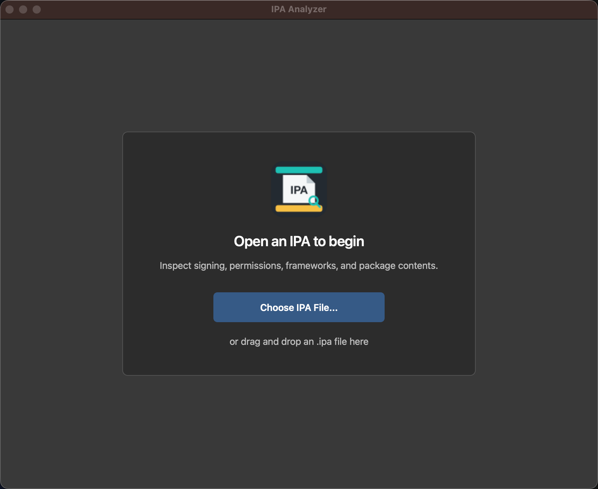
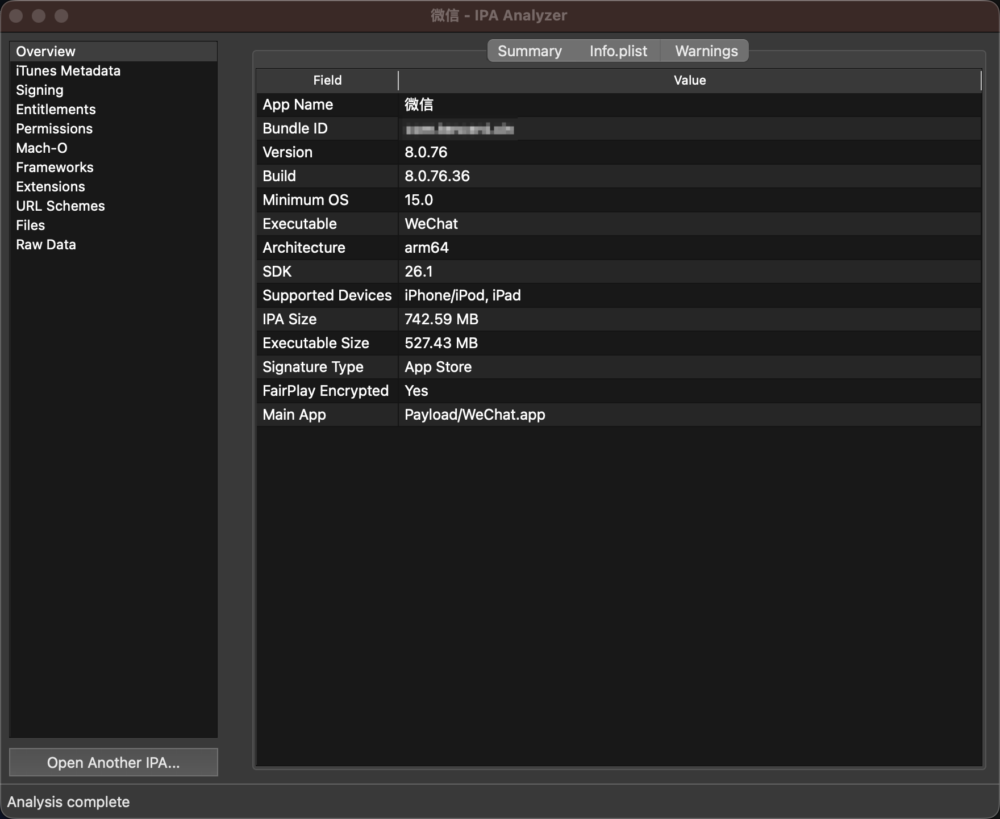
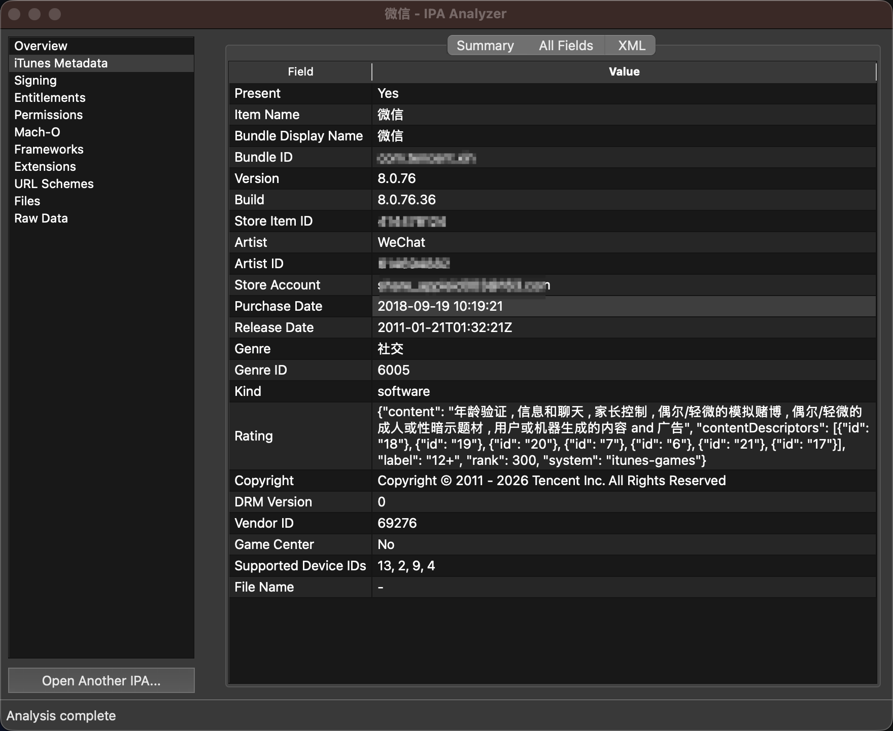

# IPA Analyzer

[English](README.md) | [简体中文](README_zh-CN.md)

IPA Analyzer is a macOS desktop application for inspecting and analyzing IPA files. All analysis is performed locally. The application only reads IPA contents and never executes bundled applications, dynamic libraries, or scripts.

## Download

- [**Download for Apple Silicon**](https://github.com/zhangshuaidongya2/IPAAnalyzer/releases/download/v0.1.2/IPA-Analyzer-0.1.2-macOS-arm64.dmg)
- [**Download for Intel Mac**](https://github.com/zhangshuaidongya2/IPAAnalyzer/releases/download/v0.1.2/IPA-Analyzer-0.1.2-macOS-x86_64.dmg)

**macOS 13+** | **Signed and notarized** | **Offline analysis**

## Screenshots

<p align="center">
  
</p>
<p align="center">
  
  
</p>

## Features

- View the application name, version, Bundle ID, icon, and file size
- Inspect the signing type, certificates, provisioning profile, and entitlements
- View supported architectures, minimum OS version, SDK, and dynamic libraries
- Review privacy permissions, URL schemes, and associated domains
- Inspect frameworks, extensions, Watch apps, and App Clips
- Inspect iTunes Store metadata when `iTunesMetadata.plist` is available
- Browse the complete IPA file tree, sizes, and hashes
- Extract standalone image files to one folder with content-based format detection
- Use summary and raw-data views with search, copy, and file preview support

## Running from Source

This option is intended for users who want to inspect the source code, contribute to development, or use the command-line analyzer.

Development requirements:

- macOS 13 or later
- Python 3.11 or later
- macOS system tools: `security`, `codesign`, `file`, `lipo`, `otool`, and `openssl`

Clone the repository and install the dependencies:

```bash
git clone https://github.com/zhangshuaidongya2/IPAAnalyzer.git
cd IPAAnalyzer
python3 -m venv .venv
source .venv/bin/activate
python -m pip install -r requirements.txt
```

Run the GUI independently with logs in the terminal:

```bash
./run_debug.sh
```

The launcher runs the current source directly, without packaging or activating the virtual
environment. On first use it creates `.venv` and installs GUI dependencies, requiring
Python 3.11+ and network access. After changing the source, close the window and run the
launcher again. `make gui` uses the same launcher; `./run_debug.sh --help` lists its options.

You can also open an IPA when launching the GUI:

```bash
./run_debug.sh "/path/to/Test App.ipa"
```

Analyze an IPA from the command line:

```bash
python main.py /path/to/Test.ipa
```

Write the complete JSON report to a file:

```bash
python main.py /path/to/Test.ipa --json report.json
```

Run the tests:

```bash
python -m unittest discover -v
```

Running from source does not require a Developer ID certificate. Activate `.venv` for the
`python main.py` commands above; `run_debug.sh` selects the project's environment automatically.

When JCTools is started with its `run_debug.sh`, the IPA analysis tool runs this project's
current source and writes logs to the same terminal. Close and reopen the analyzer to load
Python changes. Use `./run_debug.sh --build` in the JCTools directory for its initial build
or native code changes; this debug build skips packaging the analyzer.

Normal JCTools builds (`./build.sh` or the release scripts) still bundle the analyzer and its
Python/Qt runtime. Normal app launches use that bundled copy without requiring source files;
updates to the packaged analyzer take effect when the app is rebuilt.

## Download and Installation

IPA Analyzer requires macOS 13 or later. Download the package for your Mac from GitHub Releases:

- Apple Silicon (M1, M2, M3, M4, and later): `IPA-Analyzer-*-macOS-arm64.dmg`
- Intel Mac: `IPA-Analyzer-*-macOS-x86_64.dmg`

Open the downloaded DMG, drag `IPA Analyzer.app` into the Applications folder, and then launch it. Release packages are signed with an Apple Developer ID and notarized by Apple.

## Usage

1. Launch `IPA Analyzer`.
2. Click `Open IPA` to select a file, or drag an `.ipa` file into the window.
3. Review key information on the summary page, then use the other pages to inspect signing, permissions, components, files, and raw data.
4. Click `Extract Image Files...` to extract the IPA's standalone image files to a folder.
5. Open or drag another IPA whenever you want to analyze a different file.

You can also right-click an `.ipa` file in Finder and select `IPA Analyzer` from the Open With menu.

## Security and Privacy

- IPA files are analyzed entirely on your Mac and are never uploaded.
- The application never executes binaries, dynamic libraries, or scripts from an IPA.
- Temporary extracted files are removed automatically after analysis.
- The application does not decrypt, modify, re-sign, or install IPA files.
- Damaged, encrypted, or unsafe archives are rejected or processed with strict limits.

## License

This project is licensed under the [MIT License](LICENSE).

## Feedback

To report a problem or suggest a feature, open a GitHub Issue and include your macOS version, IPA Analyzer version, and a description of the problem. Do not upload IPA files containing sensitive information or unreleased application data.
