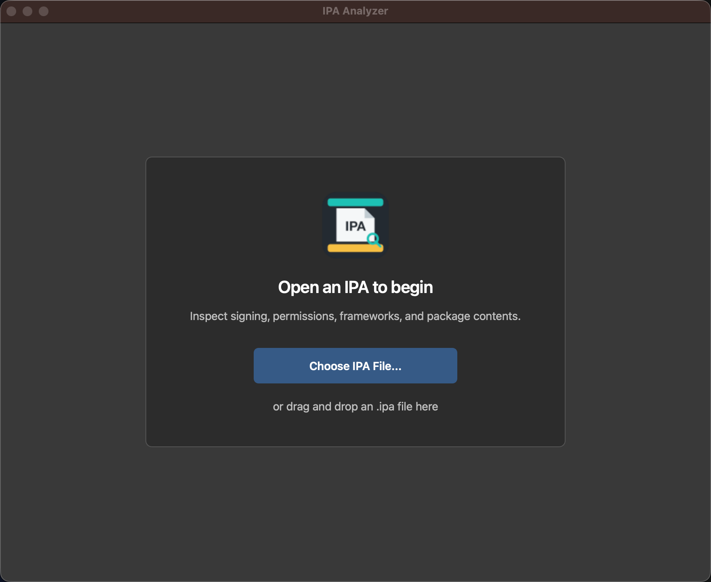
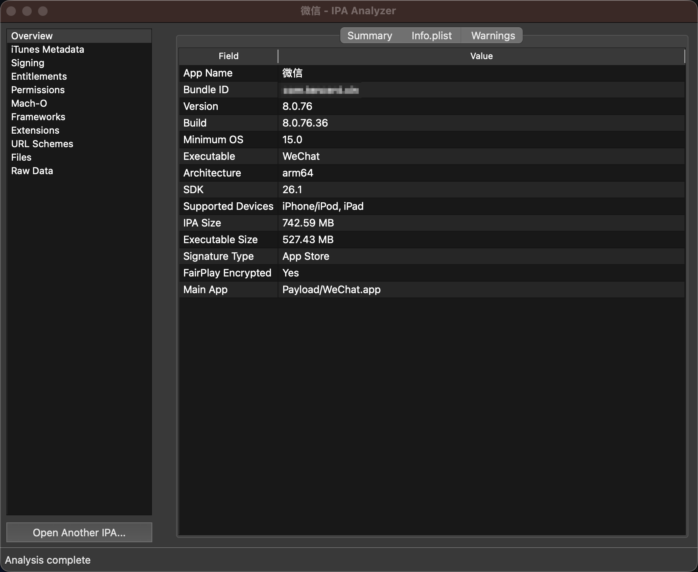
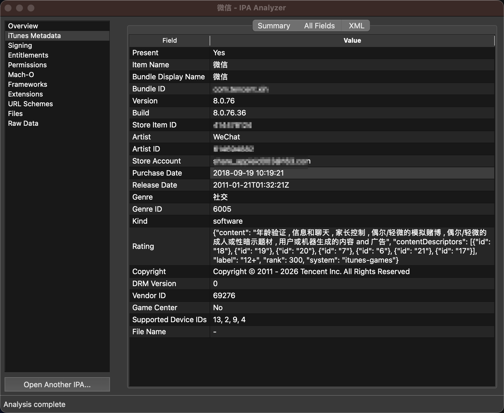

# IPA Analyzer

[English](README.md) | [简体中文](README_zh-CN.md)

IPA Analyzer 是一款用于查看和分析 IPA 文件的 macOS 桌面工具。所有分析均在本机完成，应用只读取 IPA 内容，不会运行其中的程序、动态库或脚本。

## 界面截图

<p align="center">
  
</p>
<p align="center">
  
  
</p>

## 主要功能

- 查看应用名称、版本、Bundle ID、图标和文件大小
- 查看签名类型、证书、描述文件和 Entitlements
- 查看支持的设备架构、最低系统版本、SDK 和动态库
- 汇总隐私权限、URL Scheme 和 Associated Domains
- 查看 Framework、Extension、Watch App 和 App Clip
- 当 IPA 包含 `iTunesMetadata.plist` 时查看 iTunes 商店元数据
- 浏览 IPA 完整文件结构、大小与哈希信息
- 按文件内容识别格式，将独立图片文件提取到同一文件夹
- 提供摘要与原始数据视图、搜索、复制和文件预览

## 从源码运行

适合希望查看源码、参与开发或使用命令行分析的用户。

开发环境要求：

- macOS 13 或更高版本
- Python 3.11 或更高版本
- macOS 系统工具：`security`、`codesign`、`file`、`lipo`、`otool`、`openssl`

克隆项目并安装依赖：

```bash
git clone https://github.com/zhangshuaidongya2/IPAAnalyzer.git
cd IPAAnalyzer
python3 -m venv .venv
source .venv/bin/activate
python -m pip install -r requirements.txt
```

在项目目录中独立调试运行 GUI，日志会直接输出到终端：

```bash
./run_debug.sh
```

脚本直接运行当前源码，不需要打包或激活虚拟环境；首次运行时会自动创建 `.venv`
并安装 GUI 依赖（需要 Python 3.11+ 和网络）。之后修改源码，退出窗口并重新运行
即可生效。也可以使用 `make gui`，或通过 `./run_debug.sh --help` 查看参数。

也可以在启动时直接打开一个 IPA：

```bash
./run_debug.sh "/path/to/Test App.ipa"
```

使用命令行分析：

```bash
python main.py /path/to/Test.ipa
```

同时输出完整 JSON 报告：

```bash
python main.py /path/to/Test.ipa --json report.json
```

运行测试：

```bash
python -m unittest discover -v
```

源码运行不需要 Developer ID 证书。上面的 `python main.py` 命令行方式需要激活
`.venv`；`run_debug.sh` 会自动使用项目的虚拟环境。

## JCTools 工具箱集成

此工程可与 `jctools` 并列放置，双方保留各自的 Git 仓库。构建 JCTools 时会将完整
分析器及 Python/Qt 运行环境打包到其 `Contents/Helpers/IPAInspector.app`，从工具箱的
“IPA 分析”入口打开独立窗口。

在 `jctools` 目录通过 `./run_debug.sh` 启动调试时，“IPA 分析”会直接调用本工程的
`run_debug.sh`，加载当前源码，日志输出到同一终端。修改 Python 代码后，关闭分析
窗口再打开即可生效。首次使用或修改 JCTools 主程序时，运行
`./run_debug.sh --build`；此调试构建会跳过分析器打包。

正常构建 JCTools（`./build.sh` 或发布脚本）仍将分析器及 Python/Qt 环境打包到 App，
正常启动使用内置副本，不依赖本机源码。因此发布包中的分析器在重新打包后更新。

本地调试工具箱模式：

```bash
./run_debug.sh --jctools --downloads-directory "$HOME/Downloads/jctoolsDownloads"
```

集成模式仅定制窗口标题和文件选择/导出的默认目录，保留全部分析与图片提取功能。
打包的最低 macOS 版本会根据 Python/Qt 二进制自动计算；较新的 PySide6 可能要求
高于 macOS 13 的系统，当前 PySide6 6.11 要求 macOS 15。

## 下载与安装

需要 macOS 13 或更高版本。请从 GitHub Releases 按 Mac 芯片下载对应安装包：

- Apple Silicon（M1、M2、M3、M4 等）：`IPA-Analyzer-*-macOS-arm64.dmg`
- Intel Mac：`IPA-Analyzer-*-macOS-x86_64.dmg`

打开下载的 DMG，将 `IPA Analyzer.app` 拖入“应用程序”文件夹，然后双击启动。Release 安装包已使用 Apple Developer ID 签名并经过 Apple 公证。

## 使用方法

1. 启动 `IPA Analyzer`。
2. 点击 `Open IPA` 选择文件，或直接把 `.ipa` 文件拖入窗口。
3. 在摘要页面查看主要信息，在其他页面查看签名、权限、组件、文件和原始数据。
4. 点击 `Extract Image Files...`，将 IPA 中的独立图片文件提取到文件夹。
5. 需要分析其他文件时，重新打开或拖入新的 IPA 即可。

也可以在 Finder 中右键 `.ipa` 文件，选择“打开方式”中的 `IPA Analyzer`。

## 安全与隐私

- IPA 分析完全在本机进行，不会上传文件或分析结果。
- 不会执行 IPA 中的二进制、动态库或脚本。
- 临时解压内容会在分析结束后自动清理。
- 不提供解密、修改、重签名或安装 IPA 的功能。
- 对损坏、加密或包含危险路径的压缩包会拒绝或限制处理。

## 许可证

本项目采用 [MIT License](LICENSE) 开源许可证。

## 反馈

遇到问题或有功能建议，可以通过 GitHub Issues 提交，并附上 macOS 版本、应用版本和问题现象。请不要上传包含敏感信息或未公开应用数据的 IPA 文件。
